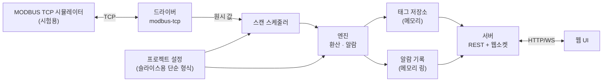

# 설계 0001. 첫 수직 조각

> 상태: **초안 — 범위 확인 전.** 구현은 시작하지 않았다. 이 문서의 범위와 작업 분해를 사용자가 확인한 뒤 체크포인트 S0부터 진행한다. 표시: [O] 관측/확정, [I] 추론/제안, [U] 미확인. 결정 기록 [0002](../decisions/0002-tech-stack-rust-core-web-ui.md), [0003](../decisions/0003-ui-delivery-browser-first.md), [0005](../decisions/0005-performance-targets.md)와 요구사항([SQ-*](../requirements/scada-quality-requirements.md))을 따른다.

## 1. 목적

기술 스택(Rust 코어·드라이버·서버 + 웹 UI)이 성능 목표를 만족하는지 가장 작은 규모로 끝까지 확인하고, 이후 기능이 얹힐 뼈대를 만든다. 결정 0002의 재검토 기준이 이 조각의 측정 결과다.

## 2. 범위

### 포함
| 영역 | 내용 |
|---|---|
| 태그 | 아날로그 입력(AI) 태그와 디지털 입력(DI) 태그 (읽기 전용) |
| 값 환산 | 환산 프로파일 0(선형), 1(코사인), 3(구간 반전), 4(무변환), 1차 지연, 범위 처리(자르기·버림) |
| 알람 | 아날로그 알람 종류 0~9, 디지털 알람 종류 0~3, 복귀 여유(히스테리시스), 알람 기록 |
| 드라이버 | MODBUS TCP 마스터 읽기(코일·입력·보유·입력 레지스터), 드라이버 인터페이스 정의 |
| 스캔 | 주기(최소 100 ms) 스캔 스케줄러, 지터 계측 |
| 서버 | 로컬 웹 서버(기본 루프백), REST + 웹소켓 |
| 웹 UI | 런타임 화면 하나: 태그 목록과 현재 값, 상태 표시, 알람 배너·목록. 다크 기본 테마 |
| 시험 | 기대값 데이터 기반 단위 시험, MODBUS 시뮬레이터 통합 시험, 지터·부하 측정 |

### 제외 (다음 조각)
쓰기와 쓰기 큐, 제어 기능, 인증·권한·감사 기록, 그래픽 편집기와 그래픽 오브젝트, 이력 저장소(슬라이스는 메모리 링 버퍼만), 기존 프로젝트 파일 읽기, 나머지 드라이버, 이중화, 오프라인 설치 패키지, 보고서, 다국어. 단 **루프백 기본 바인딩**과 외부 서비스 비의존은 처음부터 지킨다.

## 3. 수용 기준

| ID | 기준 | 근거 |
|---|---|---|
| AC-1 | [기대값 데이터](../../tests/fixtures/expected/README.md)의 `ai-scaling`, `alarm`의 모든 사례를 통과한다 | 결정 0010 |
| AC-2 | MODBUS TCP 시뮬레이터의 레지스터 값이 100 ms 주기로 읽혀 웹 화면에 보이고, 값이 임계를 넘으면 알람이 표시되고 복귀한다 | SQ-C02, SQ-A01 |
| AC-3 | 지터 99번째 백분위수가 설정 주기의 ±20% 이내다 (기준 하드웨어에서 측정, 결과를 문서화) | 결정 0005 |
| AC-4 | 태그 10,000개, 브라우저 클라이언트 50개 부하에서 AC-3을 유지한다 | 결정 0005 |
| AC-5 | 외부 네트워크 없이 빌드 산출물만으로 실행된다 (CDN·외부 글꼴 없음) | 결정 0003 |
| AC-6 | 세 OS(Windows, Linux, macOS)에서 빌드·실행되고 x86-64와 arm64 중 둘 이상의 조합에서 시험을 통과한다 | 결정 0001·0003 |
| AC-7 | 의존성 라이선스 검사(허용 등급만)와 의존성 목록 생성이 CI에서 동작한다 | 의존성 정책 |

## 4. 구조



### 4-1. 작업 공간 구성 (제안)

| 요소 | 역할 | 의존 |
|---|---|---|
| `core` | 태그 모델, 환산, 알람 엔진, 알람 기록. **I/O 없음, 순수 로직** | 표준 라이브러리, 직렬화 |
| `driver-api` | 드라이버 인터페이스(trait)와 공통 형식(주소, 값, 오류) | `core` |
| `driver-modbus-tcp` | MODBUS TCP 마스터 | `driver-api` |
| `scheduler` | 주기 스캔, 지터 계측, 드라이버 호출 격리 | `core`, `driver-api` |
| `server` | REST·웹소켓 서버, 정적 웹 자산 서빙 | `scheduler`, `core` |
| `sim-modbus` | 시험용 시뮬레이터(개발·CI 전용, 배포 제외) | — |
| `web/` | TypeScript 웹 UI | 서버 API |
| `tests/fixtures/` | 기대값 데이터 | — |

순수 로직(`core`)을 I/O에서 분리해 기대값 데이터로 직접 시험하고 지터와 무관하게 검증한다 [I].

### 4-2. 스케줄러와 지터 [I]

- 태그마다 스캔 주기를 갖고, 같은 장치·같은 주기의 읽기는 블록으로 묶는다.
- 스캔 시각은 단조 시계 기준 절대 시각을 쌓아 계산해 지연이 누적되지 않게 한다.
- 드라이버 호출은 독립된 작업 단위로 실행하고 타임아웃을 둔다. 한 장치의 지연이 다른 장치의 스캔을 막지 않는다.
- 지터는 (실제 시작 시각 − 계획 시각)을 기록해 99번째 백분위수와 최댓값을 노출한다 (SQ-R02).

### 4-3. 드라이버 인터페이스 (스케치) [I]

```rust
// 실제 정의는 crates/driver-api. 읽기 단위는 ReadBlock 하나다.
trait Driver: Send {
    fn connect(&mut self) -> impl Future<Output = Result<(), DriverError>> + Send;
    fn read(&mut self, block: &ReadBlock) -> impl Future<Output = Result<BlockData, DriverError>> + Send;
    fn status(&self) -> LinkStatus; // 연결, 마지막 왕복 시간, 성공/실패 횟수
}
```

GUI 결합이 없고 읽기·상태만 갖는다 (SQ-C01). 쓰기는 다음 조각에서 추가한다. 이 트레이트는 동적 호출(`dyn`)이 안 되므로, 스케줄러는 드라이버 종류별 열거형이나 제네릭으로 다룬다 [S3에서 확정].

## 5. 규칙 명세

정확한 입력과 기대 출력은 **기대값 데이터가 규범**이며 이 절은 요약이다. 두 곳이 다르면 데이터를 따르고 이 절을 고친다.

### 5-1. 값 환산

입력: 원시 값 `v`, 장치 범위 `[pb, pf]`, 표시 범위 `[b, f]`. `span = pf − pb`.

| 프로파일 | 규칙 |
|---|---|
| 0 선형 | `span ≠ 0`이면 `(v − pb)·(f − b)/span + b`, `span = 0`이면 0 |
| 1 코사인 | `span = 0`이면 0. 아니면 `deg = clamp((v − pb)·180/span − 90, −90, 90)`, `out = cos(|deg|를 라디안으로)·(f − b) + b`, `deg < 0`이면 `−out` |
| 3 구간 반전 | `span = 0`이면 0. `mid = span/2 + pb`. `v < mid`이면 `−((v − pb)·2·(f − b)/span + b)`. 아니면 `v' = v − span`, `out = (v' − pb)·2·(f − b)/span + b`, 결과는 `f − out` |
| 4 및 그 밖 | 무변환 |

- **1차 지연** (지연 `d`, 0이면 없음, 상한 1000): `new = (이전 환산값·d + 환산값)/(d + 1)`. 계산은 32비트 부동소수 정밀도로 한다 (기대값에 반영됨).
- **범위 처리**: 방식 1 = `[b, f]`로 자르기, 방식 2 = 범위 밖이면 값을 버리고 이전 값을 유지한다.
- 음의 영(`-0`)을 구분하는 사례가 데이터에 있다. 비교는 값과 부호를 함께 본다.

### 5-2. 아날로그 알람

한계 값: HIHI(상상한), HIGH(상한), LOW(하한), LOLO(하하한), 복귀 여유 `g`. 상태: 정상, LOLO, LOW, HIGH, HIHI, (종류 9만) MIDDLE.

| 종류 | 사용하는 한계 | 요약 |
|---|---|---|
| 0 | HIHI, LOLO | 양쪽 극한 |
| 1 | HIHI | 상 극한만 |
| 2 | LOLO | 하 극한만 |
| 3 | HIGH, LOW | 양쪽 일반 |
| 4 | HIGH | 상 일반만 |
| 5 | LOW | 하 일반만 |
| 6 | HIHI, HIGH, LOW, LOLO | 4단계 |
| 7 | HIHI, HIGH | 상측 2단계 |
| 8 | LOLO, LOW | 하측 2단계 |
| 9 | HIGH, LOW | 범위 안(MIDDLE)과 밖의 전이를 기록 |

- 한계에 도달(`≥` 상측, `≤` 하측)하면 해당 상태로 전이하고 기록을 남긴다 (같은 상태가 이어지면 기록 없음).
- 복귀: 상측 상태에서 값이 `한계 − g`보다 작아지면, 하측 상태에서 `한계 + g`보다 커지면 "확인 기록(CNF)" 뒤에 "복귀(RETURN)" 기록을 남기고 정상으로 간다. 종류 6~8에서 극한→일반 전이(HIHI→HIGH, LOLO→LOW)는 같은 복귀 여유를 쓴다.
- 종류 9는 위와 다르게 동작한다: 범위 `[LOW, HIGH]` 안으로 들어오면 상태 MIDDLE과 기록 종류 HIGH, 밖으로 나가면 RETURN. 세부 경계는 데이터를 따른다.

### 5-3. 디지털 알람

| 종류 | 값 1로 변화 | 값 0으로 변화 |
|---|---|---|
| 0 | DI_ON | RETURN |
| 1 | RETURN | DI_OFF |
| 2 | (없음) | DI_OFF |
| 3 | DI_ON | (없음) |

- 기록은 값이 **변할 때**만 남긴다. 입력 직전 값은 0으로 시작한다 (초기 상태 처리는 다음 조각에서 정한다 [U]).

### 5-4. 슬라이스에서 하지 않는 규칙
스크립트 환산, 역률 태그, 큰 변화 보호(벽시계 의존), 변화율 알람, 알람 확인(ACK) 절차.

## 6. 서버 API (초안) [I]

구현된 형식은 [설계 0003](0003-api-v1.md)이 규범이다. 아래는 초안 요약이다.

| 경로 | 설명 |
|---|---|
| `GET /api/v1/tags` | 태그 목록과 현재 값, 품질, 갱신 시각 |
| `GET /api/v1/alarms` | 활성 알람과 최근 기록(링 버퍼) |
| `GET /api/v1/status` | 장치 연결 상태, 스캔 지터(99번째 백분위수, 최댓값), 처리량 |
| `WS /api/v1/stream` | 값 변경과 알람 이벤트의 푸시. 변경된 항목만 보낸다 |

- 타입은 한 곳에서 정의해 TypeScript로 생성한다(도구는 S3에서 선택) [I]. 시간은 UTC 기준으로 보낸다.
- 기본 바인딩 루프백, 외부 노출은 명시 설정으로만 켠다 (SQ-S06).
- 이 조각에는 인증이 없으므로 **외부 바인딩은 시험 목적의 설정 플래그로만** 허용하고 문서에 경고를 둔다.

## 7. 웹 UI (최소) [I]

- 화면 하나: 상단 상태 줄(연결, 알람 수, 지터), 태그 표(이름, 값, 단위, 상태 칩, 갱신 시각), 알람 목록.
- 디자인: 다크 기본, 상태는 색 + 아이콘 + 문구([0004](../decisions/0004-design-direction.md)). 디자인 토큰은 이 조각에서 최소 집합만 정의한다.
- 갱신: 웹소켓의 변경분만 적용하고 변경된 행만 다시 그린다 (SQ-G07).
- 프레임워크: 후보를 비교해 S3에서 정한다 [U]. 의존성은 허용 등급만, 모든 자산은 번들에 포함한다.

## 8. 슬라이스용 프로젝트 설정 [I]

원본 형식이 아니라 **단순한 텍스트 형식**(예: TOML)을 쓴다. 장치, 태그(이름, 주소, 환산 파라미터, 알람 파라미터), 스캔 주기만 담는다. 기존 프로젝트 파일 읽기는 다음 조각에서 별도 모듈로 추가한다 (결정: 읽기 필수·쓰기 선택).

## 9. 시험 계획

| 종류 | 내용 |
|---|---|
| 단위 | `core`가 기대값 데이터를 읽어 환산·알람을 모두 비교. 사례 이름으로 실패 위치를 표시 |
| 통합 | `sim-modbus`와 드라이버·스케줄러·서버를 연결해 레지스터 변화 → API 값 → 알람 기록까지 확인 |
| 성능 | 지터 분포 측정, 태그 10,000개·클라이언트 50개 부하, 메모리·핸들 추세 (72시간 시험은 다음 조각) |
| 웹 | 컴포넌트 단위 시험과 시각 회귀 시험의 기초 |
| 호환 | 세 OS, 두 CPU 매트릭스 CI. 의존성 라이선스·취약점 검사 |

## 10. 의존성 후보 [U]

모두 의존성 정책의 허용 등급이어야 하며 검사 도구로 확인한 뒤 확정한다.

| 영역 | 후보 |
|---|---|
| 비동기 런타임·서버 | `tokio`, `axum` |
| 직렬화·설정 | `serde`, `toml` |
| MODBUS | 자체 구현 (결정 0013) |
| 로그·계측 | `tracing` |
| 웹 | TypeScript + 번들러(Vite 등) + 가벼운 UI 프레임워크(후보 비교는 S3) |
| 시험 | `cargo test`, 웹 시험 도구 |

## 11. 작업 분해와 체크포인트

| 단계 | 내용 | 체크포인트 (사용자 확인) |
|---|---|---|
| S0 | 개발 위치 결정(완료: 0012), 작업 공간 골격과 CI(라이선스 검사 포함) | 골격 확인 |
| S1 | `core`: 태그 모델, 환산, 알람, 기대값 시험 통과 (AC-1) | AC-1 통과 |
| S2 | `driver-api`, `driver-modbus-tcp`, `sim-modbus` | 시뮬레이터 읽기 성공 |
| S3 | `scheduler`와 지터 계측, `server` API, 웹 프레임워크 결정 | API 시연 (완료, 프레임워크는 Svelte 5로 확정: [0014](../decisions/0014-web-ui-svelte.md)) |
| S4 | 웹 UI 최소 화면, 알람 표시 (AC-2) | 화면 시연 (구현 완료: 서버가 `web/dist`를 제공) |
| S5 | 성능 측정(AC-3, AC-4), 세 OS·두 CPU 빌드(AC-6), 의존성 검사(AC-7) | **스택 재검토 판단 (결정 0002)** |

## 12. 열린 결정

| 번호 | 항목 | 제안 |
|---|---|---|
| D-1 | 구현 코드를 어디서 개발하나 | **해소**: 이 저장소에서 직접 개발한다 ([0012](../decisions/0012-development-location.md)) |
| D-2 | 웹 UI 프레임워크 | **해소**: Svelte 5 ([0014](../decisions/0014-web-ui-svelte.md)) |
| D-3 | 슬라이스용 설정 형식 | TOML |
| D-4 | 기준 하드웨어 | 4코어·8 GB급 산업용 PC 후보 (미정) |
| D-5 | MODBUS 구현 방식 | **해소**: 직접 구현 ([0013](../decisions/0013-modbus-tcp-implementation.md)) |
| D-6 | 이력 저장소 스키마 | 이 조각 밖 (다음 조각) |
